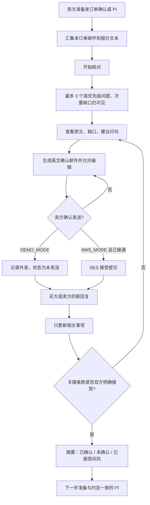
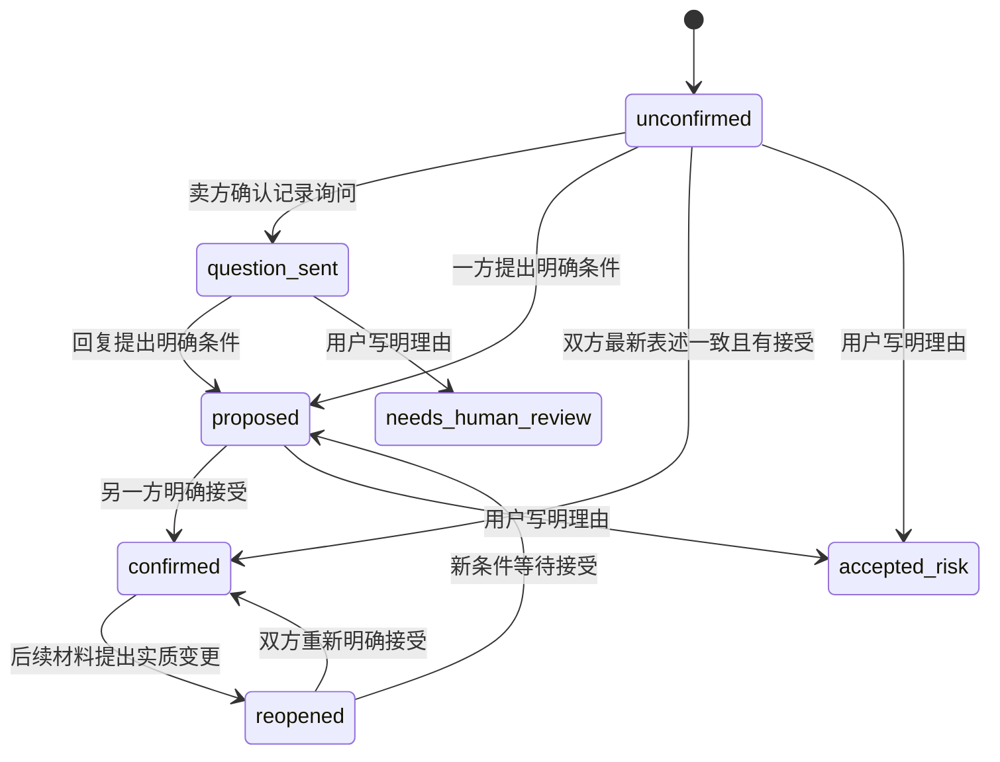
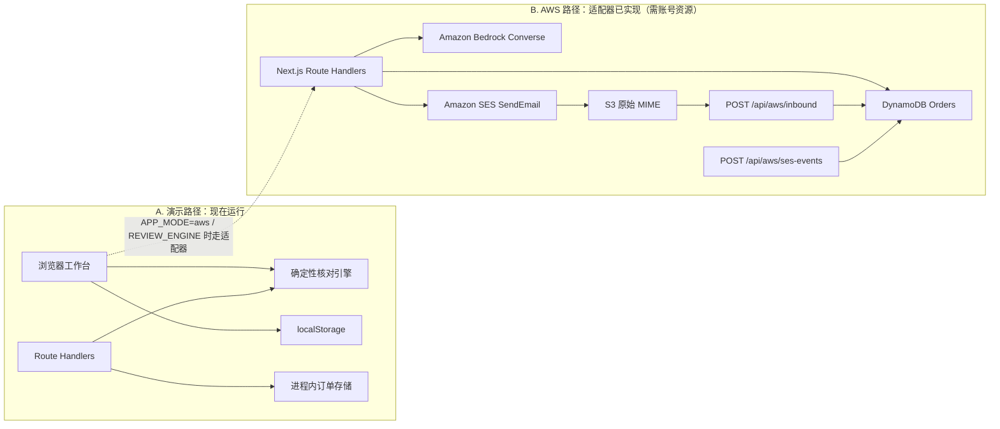
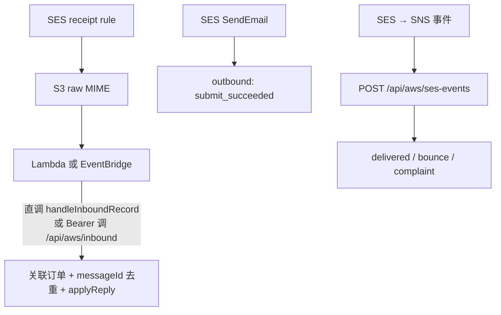
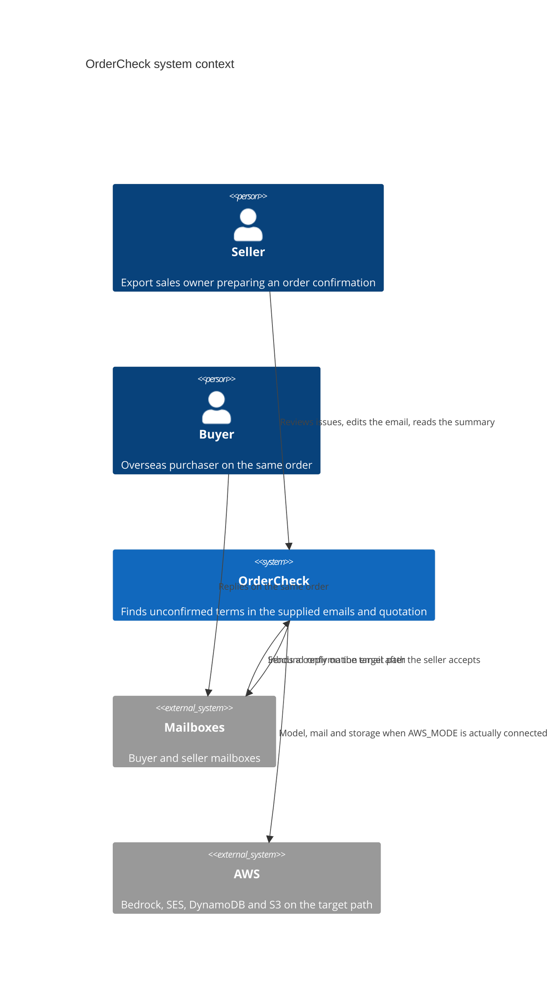
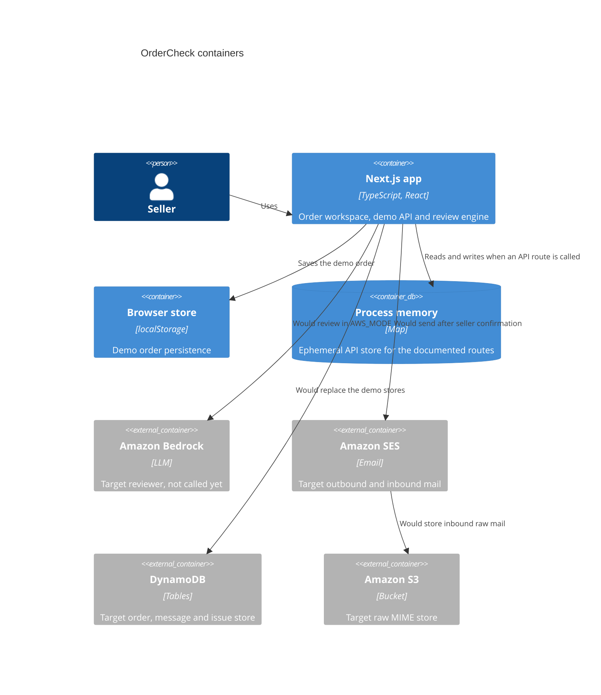
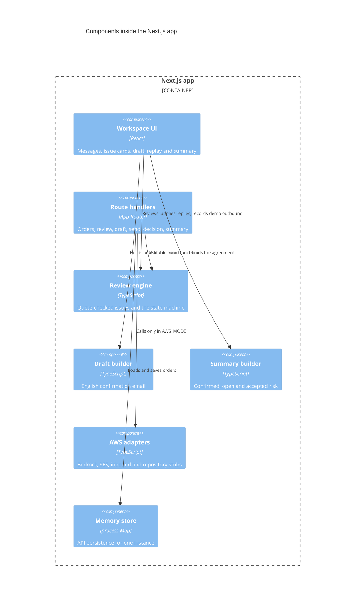
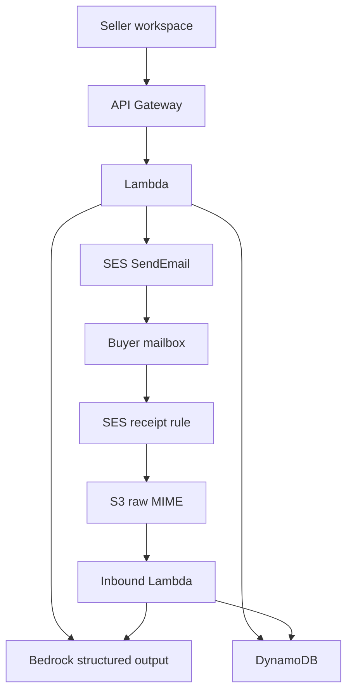

# OrderCheck 架构

版本：2026-10-25。有两条路径：现在就能公开跑通的演示路径，以及交接文档里的 AWS 目标路径。演示路径是实现；目标路径是接口和失败行为，不是已经接通的云资源。

## 业务流

卖方在发形式发票之前，把这一张订单的邮件和报价交给 OrderCheck。系统列出有原文的缺口，卖方编辑并确认一封英文询问。对方的新回复只改变相关事项。双方都写明并接受之后，才进入约定摘要。



样例回放走同一条「新回复」分支，但来源标签是样例或手工录入。它不进入 SES 收件。

事项状态：



没有新的明确条件时，`question_sent` 保持已提问。含糊回复不产生迁移。

## 技术架构



### Infrastructure as Code

可部署定义（评委可审，本地可不 `sam deploy`）在 [`infra/`](../infra/)：

- `infra/template.yaml` — AWS SAM：SES 收件规则概念、加密且阻止公有的 S3 原始邮件桶、S3→Lambda→`POST /api/aws/inbound`、SES 事件 SNS→Lambda→`POST /api/aws/ses-events`、DynamoDB `ORDERS_TABLE_NAME`、应用运行时 IAM（Bedrock `InvokeModel`/`Converse`、SES `SendEmail`、S3 `GetObject`、DynamoDB CRUD）
- `infra/README.md` — 参数（Domain / FromAddress / AppBaseUrl / WebhookSecret）、如何接 Vercel 环境变量、与应用代码对应关系
- 运行时 SDK 逐文件对照见 [`CDS_RUNTIME.md`](./CDS_RUNTIME.md)

### 已实现适配器 vs 需账号资源

| 能力 | 代码状态 | 运行时前提 |
|---|---|---|
| Bedrock Converse + tool + 可选 1 次 agent 重试 | 已实现 `lib/aws/bedrock.ts` | `AWS_REGION` + `BEDROCK_MODEL_ID` + 模型权限 |
| SES SendEmail | 已实现 `lib/aws/ses.ts` | AWS 模式 + 已验证 `SES_FROM_ADDRESS` |
| DynamoDB 整单 JSON | 已实现 `DynamoOrderRepository` | `ORDERS_TABLE_NAME`；否则 Memory |
| S3 GetObject 入站 MIME | 已实现 `handleInboundRecord` | `RAW_EMAIL_BUCKET` + IAM |
| 入站 / 投递事件 HTTP | 已实现受保护 API | `INBOUND_WEBHOOK_SECRET`；生产优先 Lambda 直调 |
| AI Gateway | 已实现备份引擎 | `AI_GATEWAY_API_KEY`；标签永远是 `ai_gateway` |

入站与事件：



演示页面直接调用引擎，所以刷新后仍能从浏览器恢复，也不依赖某一次无服务器实例还活着。Route Handler 使用同一套函数，方便以后把页面改成调用 API。

## C4

### Context



演示路径上，买卖双方的邮件是用户加载或粘贴的文本。系统不登录他们的邮箱。

### Container



### Component

组件图描述 Next.js 应用内部。AWS 适配器在同一应用里，是目标路径的边界，不是已部署的 Lambda。



## 演示路径

| 步骤 | 实现 |
|---|---|
| 加载 DEMO-001 | `createOrderFromScenario()` 读取 `docs/handoff/demo-scenario.json` 的订单和初始邮件 |
| 核对 | `reviewOrder()`。不读取 `expected_issues` |
| 草稿 | 三个高优先级问题都还开放时，使用交接文档中的英文草稿；否则按所选问题生成，不新增商业承诺 |
| 发送 | `recordOutbound()`。状态 `recorded_not_sent` |
| 回放 | `applyReply()`，来源 `fixture` 或 `manual` |
| 摘要 | `buildSummary()` |
| 持久化 | 浏览器 `localStorage` 键 `ordercheck.demo.v1` |

页面徽章：

- `DEMO_MODE`：默认。
- `AWS_MODE`：`APP_MODE=aws` 或 `AWS_MODE=true`。

## 目标 AWS 路径



建议的最小资源：

- Amazon Bedrock：抽取证据、提出补问、判断新回复影响。输出必须符合 `lib/review/schema.ts`。
- Amazon SES：发信和收信。发信 API 成功只记 `submit_succeeded`。投递事件才记 `delivered`。
- DynamoDB：订单、消息、事项状态、发送记录、确认历史。
- S3：原始 MIME。附件以后再分析，不执行邮件里的指令。
- AgentCore 不是首版前提。

入站处理要做的事：用随机订单回复标识和已登记参与方关联会话；去掉引用历史和自动签名；按 message id 去重；关联不上的邮件保持人工处理。重试不能再次创建同一问题或再次发信。这些规则的演示版已经做在引擎里，云上入口是 `handleInboundRecord`。

## 环境变量

见 `.env.example`。仓库不放密钥，也不放可用的真实邮箱。

| 变量 | 用途 |
|---|---|
| `APP_MODE` | `demo` 或 `aws` |
| `DEMO_MODE` | 设为 `true` 表示样例。不能覆盖已经打开的 AWS 模式 |
| `AWS_MODE` | `true` 等价于 `APP_MODE=aws` |
| `AWS_REGION` | Bedrock 和 SES 区域 |
| `BEDROCK_MODEL_ID` | 结构化核对用的模型 |
| `BEDROCK_MAX_TOKENS` | 预留的输出上限 |
| `ORDERS_TABLE_NAME` | 订单表 |
| `MESSAGES_TABLE_NAME` | 消息表 |
| `ISSUE_EVENTS_TABLE_NAME` | 状态历史表 |
| `RAW_EMAIL_BUCKET` | 原始 MIME |
| `SES_FROM_ADDRESS` | 已验证的发信身份 |
| `SES_REPLY_TO_ADDRESS` | 订单回复地址 |
| `SES_CONFIGURATION_SET` | 投递事件 |
| `INBOUND_DOMAIN` | 收件域名 |

AWS 模式如果缺前六个关键项里的任何一个，配置接口会返回缺失的变量名。

## 接口形状

演示 API 和目标 API 使用同一路径。入站邮件不是其中的公网 POST。

| 方法 | 路径 | 行为 |
|---|---|---|
| `GET` | `/api/config` | 模式、缺失变量名、各项是否已填写 |
| `POST` | `/api/orders` | `{ "fixture": "DEMO-001" }` 创建未核对订单 |
| `GET` | `/api/orders/:id` | 读取订单 |
| `POST` | `/api/orders/:id/messages` | 追加材料或回复。拒绝 `ses_inbound` |
| `POST` | `/api/orders/:id/review` | 按 `reviewEngine` 真实核对；返回 `engine` / `meta`（含 request id） |
| `POST` | `/api/orders/:id/email-draft` | `{ "issue_ids": [] }` 生成草稿 |
| `POST` | `/api/orders/:id/send` | DEMO 记 `recorded_not_sent`；AWS+SES 真发 → `submit_succeeded` |
| `GET` | `/api/health` | mode、引擎、bedrock/ses/dynamo/s3/gateway/inbound 布尔与 missing |
| `POST` | `/api/aws/inbound` | 受保护入站（需 `INBOUND_WEBHOOK_SECRET`） |
| `POST` | `/api/aws/ses-events` | 受保护 SES 事件 → delivered/bounce/complaint |
| `POST` | `/api/orders/:id/issues/:issueId/decision` | `{ decision, reason, actor }` |
| `GET` | `/api/orders/:id/summary` | 约定摘要 |

错误体：

```json
{ "error": { "code": "ses_not_implemented", "message": "SES 发信适配器尚未接通。样例模式只会把外发记在订单里。" } }
```

订单、事项和摘要的 TypeScript 形状在 `lib/types.ts`。Bedrock 目标请求在 `lib/aws/bedrock.ts`：`{ modelId, region, order, schema }`。SES 目标请求在 `lib/aws/ses.ts`：`{ from, to, replyTo, subject, textBody, configurationSet }`，成功时只允许 `{ messageId, status: "submit_succeeded" }`。

DynamoDB 单条订单文档可以先按 `Order` 整存。消息多了以后再拆到 `MESSAGES_TABLE_NAME`，事项历史拆到 `ISSUE_EVENTS_TABLE_NAME`。

## 持久化与幂等

- 浏览器保存整张 `Order`。重新加载样例会覆盖它。
- API 的 `MemoryOrderRepository` 挂在进程上。新实例是空的，`GET` 返回 404。
- `DynamoOrderRepository` 在 AWS 模式且表名已填时用 SDK 读写；失败会抛错，不会静默写到内存里冒充已经入库。
- 消息 id 重复时返回 409，不追加历史，不追加外发。
- 同一组已经是「已提问」的事项不能再次记录发送。

## 失败时用户看到什么

- 没有材料就核对：请先加载邮件。
- 空回复、空理由、空收件人：停在原状态，并写明缺什么。
- 引用无法在原文定位：该条证据不出现。
- AWS 模式缺少配置或适配器未接通：红色说明，不出现「已投递」或「模型已核对」。
- 本机样例损坏：忽略本地缓存，可以重新加载 DEMO-001。

## 接通 SES 和 Bedrock 的下一步

1. 在所选区域验证发信身份，确认沙箱是否只能发给已验证地址。把测试邮箱换成团队自己的地址，不要用 example.com。
2. 配置收件域名和 MX，让回复进入 S3。用一封真实邮件跑通 `handleInboundRecord` 的去重和订单关联。
3. 给 Bedrock 调用接上 Converse 或等价 API，强制 `reviewIssueJsonSchema`。返回后跑现有的引用校验和状态合并。
4. 只有 SES 事件把投递状态写成 `delivered`。发送函数本身不得写这个状态。
5. 用 DynamoDB 替换两个演示存储之前，先保持样例模式可一键复现。
6. 补一条真实发信和真实收件的演示记录：message id、原始对象键、状态变化。不要补写节省金额。
